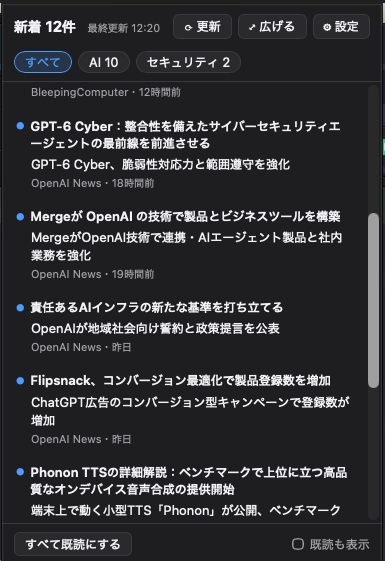
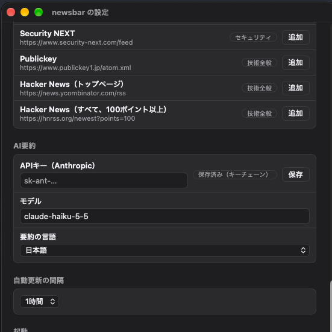
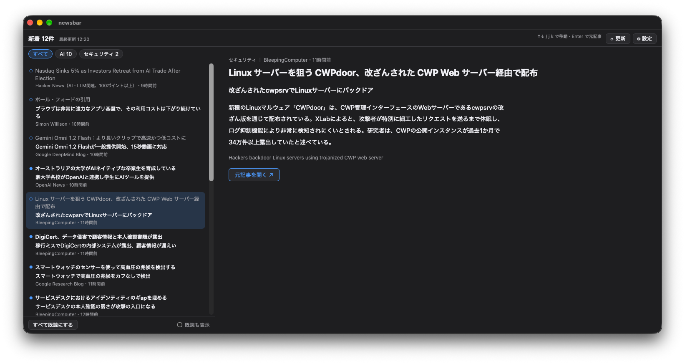
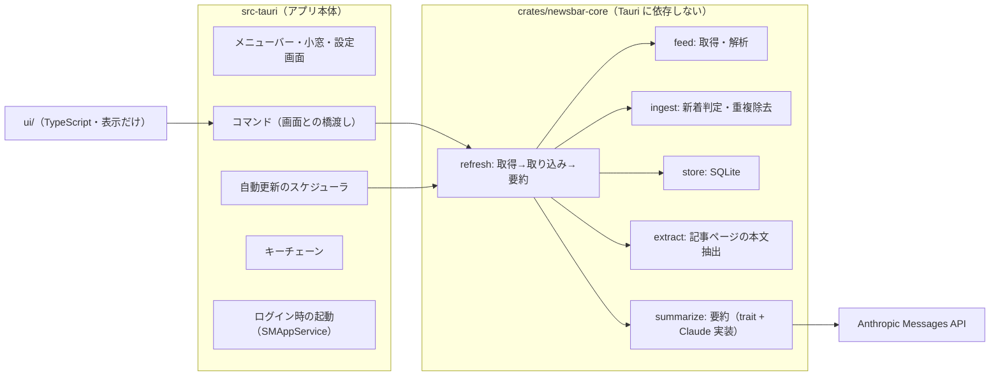

# newsbar

> A macOS menu bar app that collects new posts from AI and security RSS/Atom feeds and summarizes them in Japanese with Claude.
> Written in Rust (Tauri 2) with a small TypeScript UI; the core logic lives in a Tauri-independent crate.
> Bring your own Anthropic API key (stored in the macOS Keychain). Runs entirely on your Mac, inside the App Sandbox.

AI・セキュリティ系のサイトの新着を集めて、Claude で日本語に要約し、Mac のメニューバーから読めるようにするアプリです。サイトを一つずつ巡回しなくても、小窓を開いて上から読めばその日の情報収集が終わる状態を目指しています。

- 名前の `newsbar` は仮のものです
- 初版は自分の Mac でビルドして使う前提です（署名・公証つきの配布はしていません）

## スクリーンショット

| 小窓（一覧） | 設定画面 |
|---|---|
|  |  |

広げて読む画面（左に一覧、右に詳しい要約。↑↓キーで1件ずつ読み進める）



## できること

- メニューバーに常駐し、未読件数を表示する（Dock にはアイコンを出さない）
- 登録した RSS / Atom / RSS 1.0（RDF）フィードを、決めた間隔（30分〜6時間）で取得する
- 新着ごとに Claude で「日本語タイトル・一言要約・2〜3文の詳しい要約」を作る
  - フィードの本文が短いとき（Hacker News など）は、記事ページから本文を取り出して要約する
- 一覧は分野（AI / セキュリティなど）のタブで切り替えられ、記事をクリックするとその場で詳しい要約が広がる
- 記事が溜まったときは「⤢ 広げる」で広い画面（左に一覧、右に詳しい要約）を開き、↑↓キーで1件ずつ読み進められる
- 情報源の追加・削除、おすすめの情報源のワンクリック追加、ログイン時の起動の設定
- 小窓と広い画面の文字の大きさを、それぞれ 4 段階から選べる
- 情報源ごとの取得の成否を記録し、設定画面に直近 7 日の失敗回数を表示する。配信元の一時的な不調（5xx・通信エラー）は 2 回続いたときだけ知らせる

取り込むのは公開から 48 時間以内の記事だけです。初回の取得や、数日ぶりに開いたときに過去の記事を大量に要約して、読み切れなくなったり費用が膨らんだりしないようにしています。

## 構成



- **core と app を分けた理由**: 判断や処理（新着判定・既読管理・件数の計算など）をすべて `newsbar-core` に置き、単体テストしやすくするためです。将来スマホ版を作るときにも使い回せます
- **画面（TypeScript）は表示と操作の受け渡しだけ**で、判断は Rust 側にあります
- **要約は trait（`Summarizer`）**にしてあるので、ほかの AI サービスや、運営側のサーバーを処理先として足せます
- 要約は構造化出力（JSON スキーマ）を使わず、`<title>…</title>` などのタグで区切ったテキストで受け取ります。effort low と構造化出力を組み合わせると、正常終了のまま中身が空の要約が返ることがあったためです

## 必要なもの

- macOS 13 以上
- Rust 1.99
- Node.js 24
- Anthropic の API キー（[Claude Console](https://platform.claude.com/) で発行）

## ビルドと起動

```sh
npm ci
npm run tauri dev      # 開発用に起動する
```

アプリとしてまとめる場合:

```sh
npm run tauri build -- --bundles app
open target/release/bundle/macos/newsbar.app
```

`.app` は App Sandbox を有効にし、ad-hoc 署名（`signingIdentity: "-"`）でまとめています。

ビルドから `/Applications` への入れ替え・起動までをまとめて行う場合:

```sh
npm run install-app
```

ビルドや Sandbox 設定の確認に失敗したときは、`/Applications` の今のアプリには手を付けずに止まります。

テストと静的チェック:

```sh
cargo fmt --all --check
cargo clippy --workspace --all-targets -- -D warnings
cargo test --workspace
npm run build
```

## APIキーの設定

1. メニューバーのアイコンをクリックし、小窓の「設定」を開く
2. 「AI要約」の「APIキー（Anthropic）」にキーを貼って「保存」を押す
3. 「保存済み（キーチェーン）」と表示されれば完了。すぐに更新が始まり、要約が付く

キーは macOS のキーチェーンにだけ保存します。設定ファイルやリポジトリには書きません。初回の読み込み時にキーチェーンの確認が出たら「常に許可」を選んでください。

## API 費用の目安

初期の情報源で 1 日あたり約 19 件の新着がある前提で、1 件あたり入力 約 3,000 トークン・出力 約 300 トークンとして概算すると、次のとおりです。

| | 1 か月のトークン数 | 単価（100 万トークンあたり） | 金額 |
|---|---|---|---|
| 入力 | 約 171 万 | $0.10 | 約 $0.17 |
| 出力 | 約 17 万 | $0.50 | 約 $0.09 |
| **合計** | | | **約 $0.26 / 月** |

- 単価は既定のモデル Claude Haiku 5.5（`claude-haiku-5-5`）のもので、2026 年 10 月時点の値です。最新の料金は [Anthropic の料金表](https://platform.claude.com/docs/en/about-claude/pricing) を見てください
- 1 回の更新で要約するのは 30 件まで、AI に渡す本文は 12,000 文字までに抑えています
- 情報源を増やしたり、設定でモデルを変えたりすると費用も変わります

## 情報源

初期状態で有効な 15 の情報源と、設定画面から追加できるおすすめの一覧は、[設計書の 7 章](docs/superpowers/specs/2026-10-26-newsbar-design.md#7-情報源) にあります。RSS / Atom を出していないサイト（Anthropic・Meta AI など）は、初版では対象外です。

## 既知の問題

- **開発中（`tauri dev`）は、ビルドし直すたびにキーチェーンの確認が出る**: 開発ビルドの署名がビルドごとに変わるためです。署名つきで配布すれば解消します
- **開発中と `.app` でデータの場所が違う**: `tauri dev` は `~/Library/Application Support/io.github.tei0110.newsbar/`、Sandbox を有効にした `.app` は `~/Library/Containers/io.github.tei0110.newsbar/` の中に DB を作ります。記事や情報源の設定は引き継がれません
- **「ログイン時に起動」は、`.app` でしか設定できない**: `tauri dev` ではアプリとしてまとまっていないため、登録に失敗して理由が表示されます
- **ほかの Mac ではそのまま開けない**: 署名・公証をしていないため、Gatekeeper に止められます。自分の Mac でビルドして使ってください
- **一言要約が 30 文字を超えることがある**: 文字数はプロンプトで頼んでいるだけで、強制していません
- **要約に失敗した記事は、自動では要約し直さない**: AI が断った・応答を読めなかった記事は、タイトルとリンクだけを表示します
- **Hacker News の一部のフィードは非公式サービス（hnrss.org）**: ときどき 502 を返します。1 回だけなら設定画面に理由が出るだけで、2 回続くと小窓に知らせが出ます

## ライセンス

[MIT](LICENSE)
